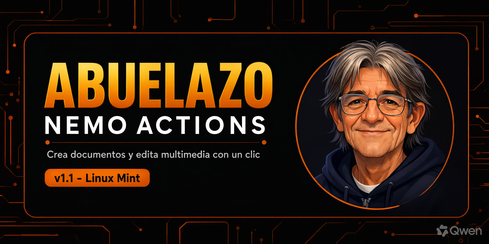

# 🐧 El Abuelazo Nemo Actions v1.1

⚡ Colección de acciones personalizadas e integración avanzada para el menú contextual del gestor de archivos Nemo en Linux Mint. ¡Potencia tu flujo de trabajo con un solo clic derecho!

## ✨ Características principales (v1.1)
* **Integración nativa y segura:** Soporte total para rutas con espacios (`Quote=double`).
* **Protección de archivos:** Nunca sobrescribe tus documentos o conversiones; crea versiones numeradas (`-2`, `-3`).
* **Suite de Oficina:** Creación instantánea de documentos de LibreOffice.
* **Multimedia Avanzado:** Conversión MKV a MP4 con fallback de audio, y extracción de audio con logs de error detallados.
* **Imágenes Pro:** Conversión a JPG manejando transparencias y miniaturas de YouTube recortadas (crop-to-fill) con compresión automática si pasan de 2MB.

## 🚀 Instalación
Descarga el archivo `.deb` desde la sección de Releases o clona este repositorio para compilarlo.

---
🌐 **Canal oficial de YouTube:** [El Abuelazo Tech](https://www.youtube.com/@ElAbuelazoTech)  
☕ **¿Te ha sido útil? Invítame a un café:** [Ko-fi de El Abuelazo Tech](https://ko-fi.com/abuelazotech)
